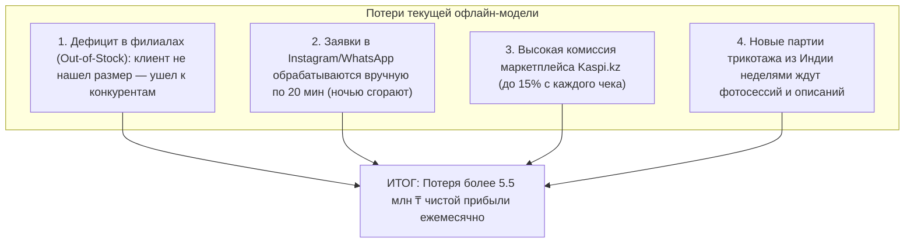
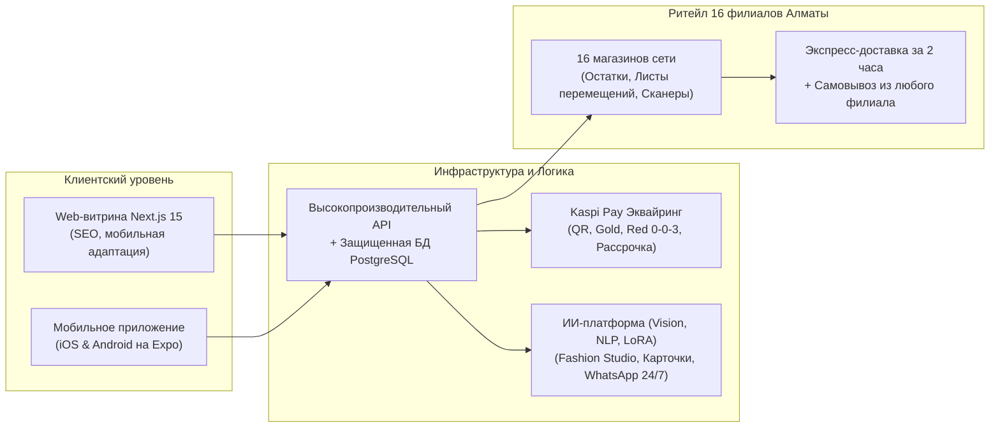
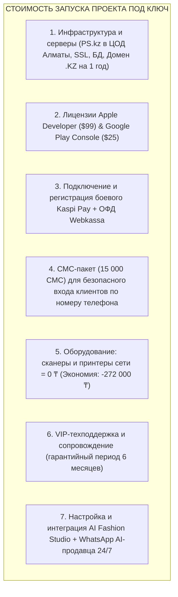
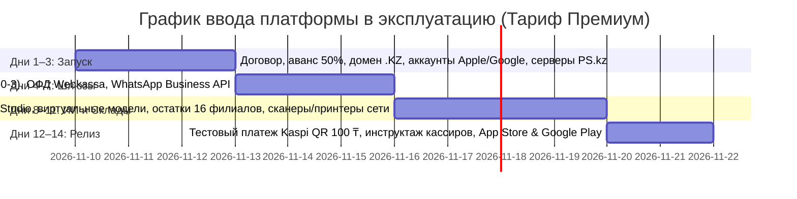

# 📊 Коммерческая презентация: Цифровая омниканальная экосистема сети «Индийский Трикотаж» (Алматы)
*Интернет-магазин + Мобильное приложение (iOS / Android) + Kaspi Pay + Сквозной учет 16 филиалов + ИИ-платформа Fashion Studio*

---

## 🎯 Слайд 1: Текущие вызовы бизнеса и точки роста (Reality Check 2026)

Сеть магазинов **«Индийский Трикотаж»** — устойчивый бренд в Алматы с 16 розничными магазинами в торговых центрах города и большой лояльной аудиторией в социальных сетях.

Однако классическая офлайн-модель без единого цифрового учета ежедневно теряет колоссальную выручку:



| Проблема | Что происходит сейчас | Результат внедрения нашей платформы |
|---|---|---|
| **Учет остатков в 16 точках** | Клиент пришел в магазин, размера нет — уходит. Товаровед не видит остатки сети | **Сквозной онлайн-мониторинг**: клиент и кассир видят остатки сети, оформляется самовывоз или перемещение |
| **Своевременное пополнение** | Полки пустеют незаметно, популярные размеры выпадают из продажи | Автоматический контроль остатков: система формирует лист пополнения филиала со склада |
| **Приём заказов 24/7** | Менеджеры переписываются в мессенджерах, отправляют номер карты вручную | Полноценный онлайн-чекаут за 30 секунд: сайт и мобильное приложение принимают оплату круглосуточно |
| **Комиссия за продажи** | Отдача до 15% маркетплейсам без получения прямых контактов клиентов | Собственный эквайринг Kaspi Pay (0.95–1.95%) и накопление своей базы лояльности |
| **Оцифровка новинок** | Долгая и дорогая аренда фотостудий и наем моделей для каждого платья | **ИИ Fashion Studio**: фото на вешалке $\rightarrow$ фотосессия на виртуальных моделях за секунды |

---

## 📱 Слайд 2: Архитектура готового решения

Платформа **не проектируется в теории — она уже разработана и функционирует**:



### Главные особенности готовой платформы:
1. **Авторизация в стиле Kaspi**: Вход по СМС без паролей, автоматическое распознавание постоянных клиентов, вход по системному **Face ID / Touch ID / коду блокировки смартфона**. Гостевой режим для мгновенных покупок.
2. **Сквозной учет 16 филиалов Алматы**: Выбор любимого магазина, фильтр каталога по наличию в конкретной точке, маршрутизация заказов и предотвращение дефицита (Out-of-Stock).
3. **Kaspi Red (0-0-3) и Kaspi Pay**: Полная поддержка оплаты долями без переплат — главный драйвер высокого среднего чека в Казахстане.
4. **Админ-панель для руководства**: CRM, управление заказами, распределение складов, учет персонала, печать ценников на принтеры сети и расширенная аналитика продаж.

---

## 🤖 Слайд 3: ИИ-инструменты для работы платформы (3 Варианта)

Искусственный интеллект кардинально снижает операционные затраты сети на персонал, фотостудии и контент:

```mermaid
flowchart TD
    subgraph ВАРИАНТ 1: AI Lite
        A1["Распознавание одежды по фото"] --> A2["Генерация описаний и состава"] --> A3["Авто-перевод на Казахский язык"]
    end
    
    subgraph ВАРИАНТ 2: AI Smart Business
        B1["Все из AI Lite"] --> B2["Умный семантический поиск"] --> B3["WhatsApp AI-Консультант 24/7<br/>(подбор размера, проверка остатков в 16 филиалах)"]
    end

    subgraph ВАРИАНТ 3: AI Fashion Studio (Флагман Премиум)
        C1["Все из AI Smart"] --> C2["Генерация фото на виртуальных фотомоделях<br/>(без найма моделей и студий)"] --> C3["Персональные кросс-сейл рекомендации"]
    end
```

### Сравнительная таблица вариантов ИИ:

| Параметр | Вариант 1: Lite (Эконом) | Вариант 2: Smart Business (Оптимальный) | ⭐ Вариант 3: Fashion Studio (Премиум) |
|---|---|---|---|
| **Назначение** | Быстрая оцифровка партий из Индии | Оцифровка + авто-продажи в мессенджерах 24/7 | Полная замена фотостудии + AI-продавец 24/7 |
| **Используемые модели** | Gemini 1.5 Flash / GPT-4o-mini | Claude 3.5 Sonnet + Embeddings + WhatsApp Bot | Flux / Stable Diffusion Fashion + GPT-4o Vision + WhatsApp |
| **Генерация карточек** | ✅ За 3 сек (название, состав, уход) | ✅ С глубокой SEO-оптимизацией | ✅ С генерацией стильных луков |
| **Языки** | Двуязычный (RU / KZ) | Двуязычный (RU / KZ) | Двуязычный (RU / KZ) |
| **Виртуальные фотомодели** | ❌ (фото как есть) | ❌ (фото как есть) | ✅ Одежда с вешалки надевается на виртуальную модель |
| **AI-продавец в WhatsApp 24/7** | ❌ | ✅ Подбирает размер, советует филиал | ✅ Подбирает размер и формирует корзину в чате |
| **Разовая настройка (Setup)** | **80 000 ₸** | **180 000 ₸** | **350 000 ₸** |
| **Расход на трафик и токены** | ~ 12 000 – 15 000 ₸/мес | ~ 35 000 – 45 000 ₸/мес | ~ 65 000 – 85 000 ₸/мес |
| **Экономия бизнеса в месяц** | ~ 150 000 ₸ (на копирайтере) | ~ 450 000 ₸ (на 2 операторах) | **~ 900 000 ₸ (на фотосессиях и моделях)** |

---

## 💼 Слайд 4: Стоимость разработки программного комплекса (ПО под ключ)

В стоимость разработки входит передача полного исходного кода, базы данных, настроенных интерфейсов и прав интеллектуальной собственности:

| Компонент разработки | Что входит в состав | Рыночная цена в РК | Наша стоимость (Тариф «Премиум») |
|---|---|:---:|:---:|
| **Интернет-магазин (Web)** | Next.js 15, каталог, фильтры, 16 филиалов, корзина, чекаут, RU/KZ | 3 500 000 ₸ | **2 800 000 ₸** |
| **Мобильное приложение (iOS & Android)** | Expo React Native, авторизация Kaspi по СМС, системный Face ID, гостевой режим, Push | 4 500 000 ₸ | **3 000 000 ₸** |
| **Админ-панель & CRM** | Сквозной учет 16 складов в реальном времени, листы перемещений, роли кассиров | 2 500 000 ₸ | **1 000 000 ₸** |
| **Интеграция Kaspi Pay & ОФД** | Привязка платежного шлюза, Kaspi Red 0-0-3, фискализация Webkassa | 1 000 000 ₸ | **450 000 ₸** |
| **Интеграция ИИ-модулей платформы** | AI Ingest, Fashion Studio (виртуальные модели) и семантический поиск | 2 500 000 ₸ | **550 000 ₸** |
| **ИТОГО СТОИМОСТЬ САЙТА И ПЛАТФОРМЫ:** | **Полный комплект ПО под ключ с исходными кодами (Премиум)** | **14 000 000 ₸** | **7 800 000 ₸** |

> 📌 **Сравнение для заказчика:** В агентствах Алматы разработка подобной системы (Web + iOS + Android + 16 филиалов + Kaspi + AI Fashion Studio) стоит **от 15 до 18 млн тенге** со сроком 6–9 месяцев. Заказчик получает готовую отлаженную систему со скидкой более **45%**.

---

## 🚀 Слайд 5: Стоимость запуска проекта (Входные расходы заказчика)

Стоимость запуска — это все обязательные внешние ресурсы, лицензии, подписки и ввод в эксплуатацию на 1-й год:



### Детальная смета стоимости запуска (Тариф «Премиум»):

| Статья расходов на запуск | Детализация статьи | Срок действия / Кол-во | Сумма (₸) |
|---|---|:---:|:---:|
| **Сервер VPS в Казахстане (PS.kz)** | Размещение в ЦОД Алматы (требование законодательства РК по защите ПДн) | 12 месяцев | 140 000 ₸ |
| **Брендовый домен `.kz` + SSL** | Официальная регистрация доменного имени и корпоративный SSL | 12 месяцев | 25 000 ₸ |
| **Облачная СУБД PostgreSQL + S3** | Защищенное хранение каталога, фото и резервное копирование каждые 6 часов | 12 месяцев | 120 000 ₸ |
| **Лицензия Apple Developer Program** | Официальная публикация приложения в App Store на имя компании ($99) | 1 год | 49 500 ₸ |
| **Аккаунт Google Play Developer** | Официальная публикация в Google Play ($25) | Бессрочно | 12 500 ₸ |
| **Боевое подключение Kaspi Pay** | Регистрация мерчанта, привязка счетов, выпуск боевых API-ключей | Разово | 90 000 ₸ |
| **Онлайн-касса и фискализация ОФД** | Интеграция фискальных чеков Webkassa | 12 месяцев | 55 000 ₸ |
| **Пакет СМС для входа клиентов** | 15 000 СМС для авторизации без паролей через Mobizon | Стартовый пакет | 118 000 ₸ |
| **Оборудование филиалов и склада** | Парк Заказчика: 16 сканеров + принтер (сопряжение 0 ₸) | В наличии у сети | **0 ₸ (Экономия: −272 000 ₸)** |
| **Настройка WhatsApp AI 24/7 (Setup)** | Разработка системных промптов (RU/KZ), вебхуки, база номенклатуры | Разово (Setup) | 180 000 ₸ |
| **Настройка AI Fashion Studio (Setup)**| Пайплайн генерации одежды на виртуальных фотомоделях под бренд | Разово (Setup) | 350 000 ₸ |
| **VIP-техподдержка и SLA (6 месяцев)** | Мониторинг 24/7, бэкапы каждые 6 часов, приоритетный саппорт SLA до 30 мин | 6 месяцев | 540 000 ₸ |
| **ИТОГО СТОИМОСТЬ ЗАПУСКА:** | **Все ресурсы, подписки, сопряжение и ввод в эксплуатацию** | **Тариф «Премиум»** | **1 680 000 ₸** |

> 🎁 **ПРЯМАЯ ЭКОНОМИЯ НА ОБОРУДОВАНИИ (−272 000 ₸):**  
> В розничной сети «Индийский Трикотаж» уже установлены 2D-сканеры на всех 16 кассах, а на складе имеется термопринтер для этикеток. Наша платформа поддерживает работу с существующим парком техники «из коробки». Покупка новых устройств не требуется — бюджет клиента экономит 272 000 ₸ на старте!

---

## 💰 Слайд 6: ИТОГОВАЯ ОБЩАЯ СУММА ПРОЕКТА (3 Тарифных пакета)

Заказчику предлагаются 3 прозрачных варианта внедрения в зависимости от масштаба:

```
┌─────────────────────────────────────────────────────────────────────────────────┐
│   ОБЩАЯ СУММА = СТОИМОСТЬ САЙТА И ПЛАТФОРМЫ + СТОИМОСТЬ ЗАПУСКА ПОД КЛЮЧ        │
└─────────────────────────────────────────────────────────────────────────────────┘
```

| Что входит в тариф | Тариф «СТАНДАРТ» | Тариф «БИЗНЕС» | ⭐ Тариф «ПРЕМИУМ / ENTERPRISE» *(ХИТ / ВЫБОР СЕТИ)* |
|---|:---:|:---:|:---:|
| **Интернет-магазин (Web)** | ✅ Полная версия | ✅ Полная версия | **✅ Полная версия** |
| **Мобильное приложение (iOS & Android)** | ✅ Полная версия | ✅ Полная версия | **✅ Полная версия** |
| **Kaspi-авторизация (Face ID / СМС)** | ✅ Включено | ✅ Включено | **✅ Включено** |
| **Сквозной учет 16 филиалов Алматы** | ✅ Включено | ✅ Включено | **✅ Включено (с контролем Out-of-Stock)** |
| **Kaspi Pay & Kaspi Red 0-0-3** | ✅ Включено | ✅ Включено | **✅ Включено** |
| **Пакет ИИ-инструментов** | **AI Lite** (оцифровка фото) | **AI Smart** (+ WhatsApp 24/7) | **AI Fashion Studio** (+ виртуальные модели) |
| **Оборудование филиалов** | Смартфоны кассиров (0 ₸) | Сканеры сети: **0 ₸** *(Экономия 240k)* | **Парк сети: 0 ₸** *(Экономия 272k)* |
| **Серверы и домен .KZ на 1 год** | ✅ Включено | ✅ Включено | **✅ Включено** |
| **Лицензии Apple & Google** | ✅ Включено | ✅ Включено | **✅ Включено** |
| **Техническая поддержка** | 1 месяц гарантии | 3 месяца саппорта | **6 месяцев (VIP-сопровождение, SLA до 30 мин)** |
| ─── | ─── | ─── | ─── |
| **1. Стоимость сайта (разработка):** | **4 900 000 ₸** | **6 200 000 ₸** | **7 800 000 ₸** |
| **2. Стоимость запуска под ключ:** | **950 000 ₸** | **1 110 000 ₸** *(экономия 240k)* | **1 680 000 ₸** *(экономия 272k)* |
| **ИТОГО ОБЩАЯ СУММА К ОПЛАТЕ:** | **5 850 000 ₸** | **7 310 000 ₸** | **9 480 000 ₸** |
| **Эквивалент в долларах США ($):** | **~ $11 700** | **~ $14 620** | **~ $18 960** |

---

## 📈 Слайд 7: Финансовый возврат и сроки окупаемости инвестиций (ROI)

Сеть «Индийский Трикотаж» уже обладает ключевым активом — **трафиком 16 магазинов и тысячами покупателей**.

### Расчет дополнительной чистой прибыли сети в месяц:
1. **Онлайн-заказы курьером по Алматы** (20 заказов/день × чек 7 500 ₸ × маржа 55%) $\rightarrow$ **+ 2 475 000 ₸ / мес**
2. **Самовывоз из 16 филиалов (Click & Collect)** — сохранение чеков (15 заказов/день) $\rightarrow$ **+ 1 856 000 ₸ / мес**
3. **Ликвидация дефицита (Out-of-Stock) благодаря учету остатков** (~12 чеков/день) $\rightarrow$ **+ 1 650 000 ₸ / мес**
4. **Экономия на комиссиях Kaspi Магазина** (перевод покупок в свое приложение) $\rightarrow$ **+ 450 000 ₸ / мес**
5. **Минус ежемесячный OPEX (серверы, СМС, ИИ-токены)** $\rightarrow$ **- 75 000 ₸ / мес**

$$\text{Итого чистая дополнительная прибыль сети} = \mathbf{+6\,356\,000\text{ ₸ в месяц}}$$

### ⏱️ Сроки окупаемости по ВСЕМ тарифам (с учетом экономии на оборудовании):

* **Тариф «СТАНДАРТ» (5 850 000 ₸):**  
  $$5\,850\,000 \text{ ₸} / 6\,356\,000 \text{ ₸} = \mathbf{0.92\text{ месяца (всего 27–28 дней)}}$$
* **Тариф «БИЗНЕС» (7 310 000 ₸):**  
  $$7\,310\,000 \text{ ₸} / 6\,356\,000 \text{ ₸} = \mathbf{1.15\text{ месяца (всего 34–35 дней)}}$$
* ⭐ **Тариф «ПРЕМИУМ / ENTERPRISE» (9 480 000 ₸):**  
  $$9\,480\,000 \text{ ₸} / 6\,356\,000 \text{ ₸} = \mathbf{1.49\text{ месяца (всего 44–45 дней)}}$$

> **Вывод:** Любой выбранный тариф окупается **менее чем за 45 календарных дней (до 1.5 месяцев)**, принося свыше **75 млн ₸ дополнительной чистой прибыли** уже в первый год работы!

---

## 🛡️ Слайд 8: Регламент сопровождения и прозрачность разработки

### Абонентское сопровождение после гарантийного периода:
* **Базовый мониторинг (150 000 ₸ / месяц):** Мониторинг серверов 24/7 (SLA 99.9%), резервное копирование каждые 6 часов, продление SSL/домена, контроль шлюзов Kaspi Pay и Webkassa.
* **Премиум DevOps (250 000 ₸ / месяц):** Все из базового + адаптация мобильных приложений под ежегодные требования iOS (Apple) и Android (Google) при выходе обновлений ОС.

### Четкое разграничение ответственности:
* Абонентская плата покрывает **только отказоустойчивость, надежность и безопасность**.
* **Разработка новых функций, модулей, маркетинговых механик или отчетов** оценивается и выполняется **исключительно на основании отдельных Дополнительных соглашений (по ТЗ или за фичу)**. Никаких «размытых часов», споров и разногласий.

---

## 📅 Слайд 9: Дорожная карта запуска Тарифа «Премиум» за 14 рабочих дней



---

## 🤝 Главный аргумент для учредителей сети:

> **«Индийский Трикотаж ежемесячно тратит миллионы тенге на аренду розничных точек в торговых центрах Алматы. 
> Инвестиция в цифровую омниканальную платформу окупается менее чем за 45 дней, экономит 272 000 ₸ на оборудовании сети, навсегда закрепляет за брендом собственную аудиторию без 15% комиссий сторонних маркетплейсов и приносит более 6.3 млн тенге дополнительной чистой прибыли каждый месяц. 
> Все исходные коды, мобильные приложения и база данных переходят в полную собственность вашей компании без роялти.»**
